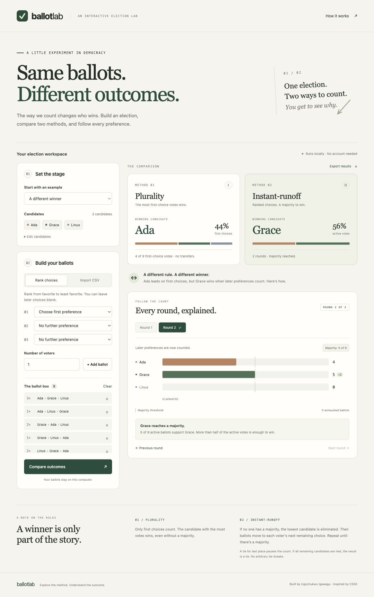

# Ballot Lab

**Same ballots. Different outcomes.** An interactive election simulator that shows how the counting method changes who wins.

Build ranked ballots, compare plurality with instant-runoff, and follow each elimination and transfer. A Python counting engine powers both the browser interface and the original command-line tool.



## Start the app

Requires **Python 3.9+**. No package installation, build step, API keys, or accounts.

Open a terminal in this repository and run:

```sh
python3 server.py
```

Open **http://127.0.0.1:8765** in your browser. Stop the server with `Ctrl+C`. If that port is occupied, use `python3 server.py --port 8766` and open the printed URL.

## A one-minute demo

1. Start with **A different winner**. Ada wins plurality with **4 of 9** first-choice votes. Grace wins instant-runoff with **5 of 9** active votes.
2. In **Round 1**, see Linus eliminated with two votes. The transfer card shows **Linus → Grace · 2**.
3. Choose **Next round**. Grace gains two votes and reaches the five-vote majority. The chart keeps a constant scale between rounds.
4. Select **When ballots run out**. In Round 2, two exhausted ballots leave seven active votes. Ada’s four votes now form a majority.
5. Select **An elimination tie**. The simulator pauses rather than choosing an arbitrary candidate to eliminate.
6. Use **Export results** to download a JSON report, including ranked ballots, vote totals, transfers, and the outcome.

See the [walkthrough and verification notes](docs/DEMO.md) and the [mobile screenshot](docs/mobile.jpg).

## Build your own election

- **Edit candidates:** enter 2–20 distinct names, one per line. Applying a changed list clears the ballot box. Names can contain spaces, but are case-sensitive and limited to 60 characters.
- **Rank choices:** select a first preference and any later preferences. Leave only trailing ranks blank. Set the number of voters to add a group of identical ballots.
- **Manage ballots:** remove a ranking group or clear the box. A notice marks old results until you compare again; stale results cannot be exported.
- **Import CSV:** paste ranked ballots or choose a local `.csv` file, then select **Apply CSV**. The validated import replaces the ballot box and runs a comparison. Invalid imports leave the current ballot box and results intact.
- **Explore results:** compare winners and vote shares, move between rounds, and inspect actual ballot transfers and exhausted ballots.

CSV has **no header**, one voter per row, highest preference first:

```csv
Ada,Grace,Linus
Ada,Linus,Grace
Grace,Ada,Linus
Linus,Grace,Ada
```

Incomplete rankings are allowed. Blank rows and trailing empty fields are ignored. Unknown candidates, repeated candidates, internal blank ranks, and empty elections are rejected. Names containing commas must be quoted, for example `"Ada, Jr.",Grace`. UTF-8 CSV with a BOM is supported. The file picker accepts files up to 1 MiB; API requests are limited to 2 MiB and 10,000 nonempty ballots.

## Command-line interface

```sh
python3 election.py examples/ballots.csv --candidates Ada Grace Linus
python3 election.py examples/ballots.csv --candidates Ada Grace Linus --output result.json
```

The CLI uses the same validation and counting rules as the browser. Existing export files are never overwritten. The report includes `candidates`, `ballots` (total), `ranked_ballots`, `plurality`, and `runoff`; eliminated rounds include explicit `transfers`, where a null destination means exhausted.

## Counting rules

| Method | What counts | Result |
| --- | --- | --- |
| Plurality | First preferences only | Most votes wins; all tied leaders are reported |
| Instant-runoff | Highest remaining preference on each ballot | More than half of the active ballots wins |

If no candidate has a majority, a unique last-place candidate is eliminated and their ballots transfer to each voter’s next remaining choice. A ballot exhausts when none of its ranked candidates remain. The majority denominator excludes exhausted ballots.

If every remaining candidate has equal votes, the result is a tie. A partial tie for last place pauses counting with an unresolved result: eliminating either candidate could affect the winner. This deliberately differs from the original CS50 exercise’s simultaneous elimination of tied last-place candidates.

The chart’s dashed marker shows the **minimum whole-number majority**, `floor(active ballots / 2) + 1`. Vote bars use the original ballot count as their scale in every round. A zero bar for an already eliminated candidate does not mean their ballots disappeared; the transfer cards explain where those ballots went.

## Architecture

```text
Browser (web/) ── POST /api/simulate ── server.py ── election.py
                                                        ↑
                                               Command-line tool
```

The frontend is plain HTML, CSS, and JavaScript with system fonts and no external assets. It renders server results rather than implementing a second counting algorithm. Candidate text is inserted using DOM text nodes. The Python standard-library server binds only to loopback, serves a fixed asset list, validates inputs, and rejects foreign origins and hosts.

Keyboard focus, labeled controls, tab navigation, live announcements, reduced-motion support, and responsive layouts are included. Colors are supplemented by names, counts, and explanatory text.

## Verification

```sh
python3 -m unittest discover -s tests -v
```

The 14 tests cover counting outcomes, incomplete ballots, exhaustion, ties, transfer destinations, quoted CSV names, validation limits, HTTP errors, static-file isolation, and exact browser-API/CLI result parity. Integration tests briefly start a loopback server.

Browser checks also cover grouped ballot entry, custom candidates, invalid CSV recovery, round navigation, export downloads, and a narrow mobile layout. See [docs/DEMO.md](docs/DEMO.md) for the reproducible checklist.

## Limits and future work

This is a local educational app, not an election-administration system. There is no voter authentication, durable ballot storage, or production web hosting. Refreshing the page resets the workspace; export results to keep a report. The development server is intended for a trusted local machine.

Future extensions: configurable tie-break rules, pairwise/Condorcet methods, saved election scenarios, and a hosted demo with an appropriate production server.

## Origins

Created by **Ugochukwu Igweagu**, inspired by the plurality and runoff exercises in [my CS50 projects collection](https://github.com/Ugo175/projects). The standalone implementation adds a browser workspace, shared validation, explicit transfers, incomplete-ballot handling, exports, and integration tests. See [ATTRIBUTION.md](ATTRIBUTION.md).
